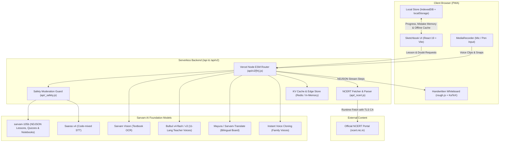

# Doodle Class

> **"A teacher for every child in Bharat: in their language, from their own textbook, in a voice they trust."**

Doodle Class is an AI-powered learning app built for Indian students in classes 1–10. A friendly cartoon teacher hand-writes lessons on an interactive whiteboard and explains difficult concepts aloud in 11 Indian languages, grounded directly in the student's official NCERT textbook.

Built from the ground up on **Sarvam AI**: `sarvam-105b` (lessons, quizzes, chat), `Bulbul v4-flash` / `Bulbul v3` (expressive voices), `Saaras v4` (code-mixed STT), `Sarvam Vision` (textbook OCR), `Mayura` (translation), and `Instant Voice Cloning` (family voice narration).

---

## Architecture



---

## Sarvam Model → What It Powers

| Sarvam Model | What it powers in Doodle Class |
|---|---|
| **`sarvam-105b`** | Whiteboard lesson generation (NDJSON stream), textbook outline sequencing, mid-lesson doubt handling ("I have a doubt"), adaptive quizzes, conversational study notebooks, and mistake memory coaching. Runs with `reasoning_effort: null` for ~9s completion latency (down from 50s). |
| **`Bulbul v4-flash` / `Bulbul v3`** | Cartoon teacher voices (Tara the owl, Chintu the robot, Mishri the cat, Gajju the elephant) and parent voice notes across 11 Indian languages with sentence-chunked pipelined playback and prefetching. |
| **`Saaras v4`** | High-accuracy speech-to-text with Indian accent and code-mixing support (Hinglish, Tanglish) for spoken doubts, voice quiz answers, and teach-back explanations. |
| **`Sarvam Vision`** | Multimodal textbook OCR; extracts multilingual text, mathematical formulas, and diagrams from smartphone camera snaps and syllabus PDFs. |
| **`Mayura` / `Sarvam-Translate`** | High-fidelity translation powering **English-medium mode** (vernacular voice + English whiteboard text) and one-tap mid-lesson language swaps. |
| **`Instant Voice Cloning`** | Family voice narration; clones a parent or grandparent's voice ("Nani") from a brief 8–15s reference recording to narrate any NCERT lesson. |
| **`Transliterate`** | Automatic script correction; converts phonetic Roman inputs into clean Devanagari and regional scripts for accurate whiteboard orthography. |

---

## Features

### 1. Learn Deeply from NCERT
Select **Class (1–10) → Subject → Book → Chapter → Section**. The deep engine parses the official NCERT chapter and teaches every core point, worked example, and textbook activity in order. A dynamic coverage checklist ticks off in real time as the teacher progresses.

### 2. Streaming Hand-Written Whiteboard
A charming sketchbook aesthetic powered by `roughjs` and `KaTeX`:
- Character-by-character handwriting reveal with baseline jitter.
- Marker colors, underline scribbles, and tape strips.
- Over 27 dynamic visual diagrams drawn in real time: fractions, number lines, ray optics, atom shells, plant cells, water cycle, and geometry.

### 3. Voice & 11 Indian Languages (English-Medium Mode)
Supports **Hindi, Tamil, Telugu, Kannada, Marathi, Bengali, Gujarati, Malayalam, Odia, Punjabi, and English**.
- **English-medium mode:** The teacher explains orally in the student's mother tongue (e.g. Hindi or Tamil) while writing clean English terminology and formulas on the whiteboard — matching how millions of Indian students actually learn.
- One-tap mid-lesson language switching.

### 4. Snap a Page (Sarvam Vision)
Point a phone camera at any textbook page or upload a syllabus PDF excerpt (`/snap`). Sarvam Vision runs OCR, balances equations, extracts diagrams, and turns the physical page into an interactive whiteboard lesson in seconds.

### 5. Circle What You Don't Understand
Students don't need to type prompts. Using the whiteboard **Pen** tool, they can draw a rough circle around any confusing line, equation, or word. The teacher detects the circled region, pauses, and immediately draws a helpful chalk analogy right below it.

### 6. Teach It Back (Misconception Detection)
At the end of a lesson, the teacher prompts: *"Now teach it back to me!"* The child explains the concept aloud via Saaras STT. `sarvam-105b` diagnoses subtle conceptual bugs (e.g. altering subscripts when balancing chemical equations) and draws an immediate corrective sketch on the board. Misconceptions are saved to the student's personal mistake memory coach.

### 7. Family Voice ("Nani")
Children learn best from voices they love and trust. Record an 8–15 second audio clip of a parent, grandparent ("Nani"), or older sibling (`/family-voice`). Using Sarvam's Instant Voice Cloning, the teacher adopts that voice for all whiteboard lessons.

### 8. Study Notebook (NotebookLM for Kids)
A personal study workspace (`/notebooks`) grounded in textbook sources:
- **Cited Q&A:** Grounded chat with inline textbook source citations.
- **Audio Overview:** A two-host conversational podcast discussing chapter highlights.
- **Mind Map:** Auto-generated visual concept trees.
- **Study Guide & Flashcards:** Active-recall decks fed into spaced repetition.

### 9. Classroom Live Quiz (Zero-Login QR)
Built for Indian classrooms and single-projector setups (`/class`):
- The teacher projects a large whiteboard with a hand-drawn QR code.
- Students scan the QR code with their phones (`/join/:code`) with **zero login or app install**.
- Real-time responses stream directly to the whiteboard with a live podium leaderboard.

### 10. Parent Voice Report
Overcomes literacy barriers for parents (`/parent`):
- Generates a warm weekly progress report as an audio voice note in the language spoken at home (e.g. Marathi, Gujarati, Hindi).
- One-tap **"Share to WhatsApp"** button sends the audio note and transcript to family groups.

### 11. Kid-Safe by Design
- **Pre-flight Moderation:** Every query, voice transcript, and textbook snap is validated through `checkSafe()` before model ingestion.
- **Zero Tracking:** No ads, no student profiles, no behavioral trackers. All progress, audio recordings, and mistake patterns are saved locally in browser IndexedDB/localStorage.

### 12. Offline & PWA Resilience
- Full Progressive Web App (PWA) with service worker caching.
- Every network call has a graceful fallback: bundled sample lessons, browser speech synthesis (`speechSynthesis`), and cached quizzes.
- **Never a broken screen:** No API key or dropped network connection ever crashes the UI.

---

## Endpoints

### Core Endpoints (`/api/*`)

| Endpoint | Method | Purpose |
|---|---|---|
| `/api/lesson` | `POST` | Full lesson as JSON |
| `/api/lesson-stream` | `POST` | Streaming NDJSON whiteboard lesson (one step per line) |
| `/api/quiz` | `POST` | Adaptive quiz questions (MCQ, True/False, Fill-in) |
| `/api/ask` | `POST` | Mid-lesson doubt; returns one inserted `LessonStep` |
| `/api/chat` | `POST` | Conversational voice/text dialogue with a teacher |
| `/api/tts` | `POST` | Bulbul speech synthesis (sentence-chunked MP3) |
| `/api/stt` | `POST` | Saaras speech-to-text transcription |
| `/api/syllabus` | `POST` | Converts uploaded syllabus PDF into custom chapters |
| `/api/coach` | `POST` | Evaluates recurring mistakes and generates remedial steps |

### Extended Endpoints (`/api/v2/*`)

Routed through `api/v2/[fn].js`:

| Endpoint | Method | Purpose |
|---|---|---|
| `/api/v2/vision` | `POST` | Sarvam Vision OCR on textbook photos and diagrams |
| `/api/v2/voiceclone` | `POST` | Family voice creation, cloning, and speech generation |
| `/api/v2/teachback` | `POST` | Evaluates kid explanations and drafts whiteboard corrections |
| `/api/v2/translate` | `POST` | Real-time translation for bilingual whiteboard mode |
| `/api/v2/report` | `POST` | Generates personalized parent progress voice scripts |
| `/api/v2/room` | `POST` | Classroom live session host/join state and leaderboard |
| `/api/v2/ncert` | `POST` | Fetches NCERT catalog and chapter section breakdown |
| `/api/v2/deep` | `POST` | Deep step-by-step textbook lesson engine with outline |
| `/api/v2/nbchat` | `POST` | Study notebook grounded chat with source citations |
| `/api/v2/podcast` | `POST` | Generates two-speaker audio overview discussions |
| `/api/v2/mindmap` | `POST` | Generates visual concept node trees from sources |
| `/api/v2/studio` | `POST` | Studio tools for notebooks (summaries, study guides) |
| `/api/v2/srcguide` | `POST` | Section-by-section textbook study guides |
| `/api/v2/fetchurl` | `POST` | Safe web article ingestion into study notebooks |
| `/api/v2/nbshare` | `POST` | Encodes and decodes shared notebook codes |
| `/api/v2/exercises` | `POST` | Solves textbook back-of-chapter exercises with hints |
| `/api/v2/examq` | `POST` | Board-exam style practice questions for classes 9–10 |
| `/api/v2/checkwork` | `POST` | Inspects student handwritten working via vision OCR |
| `/api/v2/parenttips`| `POST` | Home-learning tips for parents in regional languages |
| `/api/v2/flashcards`| `POST` | Generates active-recall flashcard decks from NCERT text |

---

## Routes

| Path | Description |
|---|---|
| `/` | Home page: teacher picker, quick topic input, recent lessons |
| `/learn/:characterId` | Interactive streaming whiteboard lesson and doubt toolbar |
| `/study` | NCERT catalog: Class 1–10 book browser and deep syllabus lessons |
| `/snap` | Snap a textbook page or upload a PDF for instant lesson generation |
| `/family-voice` | Record or select a family voice ("Nani") to narrate lessons |
| `/notebooks` | Study Notebooks overview (NotebookLM-style workspace) |
| `/notebook/:id` | Interactive notebook: source inspector, cited chat, audio overview |
| `/nb/:code` | Shared notebook viewer |
| `/class` / `/class/:code` | Classroom projector host view with live QR code & podium |
| `/join` / `/join/:code` | Mobile student join view for classroom quizzes |
| `/parent` | Spoken WhatsApp voice report for parents in regional languages |
| `/practice` | Quick quiz mode without a preceding lesson |
| `/quiz` | Post-lesson quiz with voice and typed answers |
| `/talk/:characterId` | Voice-to-voice conversational study session with a teacher |
| `/journey/:characterId`| Gamified textbook chapter map with boss battles |
| `/boss/:characterId/:ch`| Timed boss battle quiz |
| `/syllabus` | Upload a school syllabus PDF to create a custom curriculum |
| `/progress` | Spaced repetition (Leitner boxes) and mastery decay dashboard |
| `/profile` | Profile customization, stats, badges, and demo data loader |
| `/about` | Impact numbers, Sarvam model architecture, and safety policies |

---

## Run Locally

```bash
# 1. Clone repository and install dependencies
git clone https://github.com/your-username/doodle-class.git
cd doodle-class
npm install

# 2. Configure environment (optional: works offline with bundled samples without a key)
echo "SARVAM_API_KEY=your_sarvam_api_key" > .env

# 3. Start local development server (mirrors /api on :8787 and Vite on :5199)
npm run dev

# 4. Run TypeScript strict type-check
npm run typecheck
```

---

## Deploy

Push to Vercel. `api/*.js` and `api/v2/[fn].js` deploy as serverless functions.
Set `SARVAM_API_KEY` in the Vercel project environment variables.
Optionally configure `UPSTASH_REDIS_REST_URL` and `UPSTASH_REDIS_REST_TOKEN` for distributed edge caching.

---

## Project Structure

```
doodle-class/
├── api/                    # Vercel serverless functions
│   ├── _sarvam.js          # Sarvam API client (chat, tts, stt, helpers)
│   ├── _ncert.js           # NCERT runtime fetcher & parser
│   ├── _deep.js            # Deep textbook lesson planner
│   ├── _vision.js          # Sarvam Vision OCR handler
│   ├── _voiceclone.js      # Instant voice cloning handler
│   ├── _safety.js          # Kid-safety moderation filter
│   ├── _cache.js           # Multi-tier response caching
│   ├── _store.js           # Upstash Redis & local memory KV store
│   ├── v2/[fn].js          # Unified router for /api/v2/* endpoints
│   └── *.js                # Core /api routes (lesson, quiz, ask, tts, stt)
├── server/
│   └── dev.js              # Local Node dev server mirroring Vercel /api
├── src/
│   ├── App.tsx             # Route registry & global Sarvam badge
│   ├── types.ts            # Shared TypeScript contracts & interfaces
│   ├── pages/              # Home, Learn, Study, Snap, FamilyVoice, About...
│   ├── components/
│   │   ├── Whiteboard/     # rough.js whiteboard canvas & drawing tools
│   │   ├── Characters/     # Cartoon teacher avatars & animations
│   │   ├── Outline/        # NCERT chapter coverage checklist
│   │   ├── Studio/         # Auto-discovered notebook studio tools
│   │   └── ui/             # Sketchbook UI kit (SketchCard, SketchButton...)
│   ├── lib/
│   │   ├── api.ts          # Client API stream helpers
│   │   ├── deep.ts         # Deep lesson client runner
│   │   ├── tts.ts          # Audio playback pipeline & prefetcher
│   │   ├── stt.ts          # Saaras voice recording & transcription
│   │   ├── vision.ts       # Sarvam Vision image processor
│   │   ├── familyVoice.ts  # Audio recording & voice cloning store
│   │   ├── demo.ts         # Demo data seeder (streak, lessons, badges)
│   │   └── progress.ts     # Spaced repetition, mastery, and stats
│   └── data/
│       ├── ncert/catalog.json # Catalog headings for classes 1-10
│       └── samples.ts      # Bundled offline sample lessons & quizzes
└── docs/
    ├── DEMO.md             # 3-minute judge demo script with timestamps
    └── SPEC.md             # Antigravity worker specifications
```

---

## NCERT Copyright Notice

Book text is fetched on-demand from official NCERT servers (`ncert.nic.in`) at runtime with verified TLS certificates and is never permanently redistributed or stored in this repository. All NCERT curriculum copyrights belong to the National Council of Educational Research and Training, New Delhi, India.

---

## Credits & License

- UI design inspired by hand-drawn classroom whiteboards and Indian sketchbooks.
- MIT License. Hand-drawn canvas rendering powered by `roughjs` (MIT). Mathematical rendering powered by `KaTeX` (MIT).
