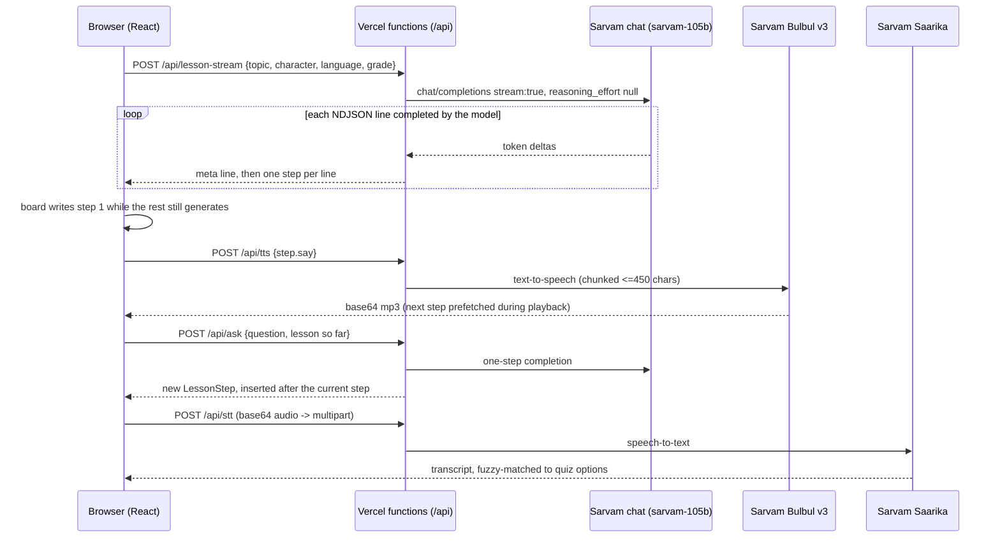

# Doodle Class

Type any topic, pick a cartoon teacher, and a lesson is hand-written on a whiteboard while the character explains it aloud in one of eight Indian languages. A quiz, voice answers and spaced-repetition review follow.

Built on Sarvam AI: `sarvam-105b` (chat), Bulbul v3 (text to speech), Saarika v2.5 (speech to text). React 19 + Vite frontend, Vercel serverless functions.

## How it works



If a step fails, the request errors, or no key is set, the browser falls back (see below) instead of showing an error screen.

## Technical highlights

- Streaming lesson generation. The model is prompted to emit NDJSON: a meta line, then one `LessonStep` per line. The server accumulates streamed deltas and forwards each complete line as soon as it parses, so the board starts writing after the first step rather than after the whole lesson.
- Latency. Setting `reasoning_effort: null` on `sarvam-105b` dropped lesson generation from about 50 s to about 9 s. `<think>` blocks are still stripped defensively in the JSON extractor.
- TTS pipelining. While step N is spoken, step N+1's Bulbul v3 audio is already being fetched. An in-flight cache keyed by text and speaker dedupes concurrent requests, so prefetch and playback never double-fetch.
- Raise your hand. `/api/ask` returns a single new `LessonStep` that is spliced into the lesson at the current position and hand-written on the board like any other step.
- Voice answers. The quiz records with `MediaRecorder`, base64-encodes the clip, and the server forwards it as multipart to Saarika. The transcript is fuzzy-matched to options (normalised, edit-distance based), including Hindi yes/no for true/false.
- Spaced repetition. Leitner boxes 1-5 with intervals 0/1/3/7/14 days, plus an exponentially decayed mastery score (half-life 3 days), shown on `/progress`. All in `localStorage`; math in `docs/ARCHITECTURE.md`.
- Graceful degradation. No key or any API error returns bundled sample lessons and quizzes; TTS falls back to the browser `speechSynthesis`; if that is missing, a timed wait proportional to text length. There is no broken-screen path.
- Hand-drawn rendering. rough.js shapes with deterministic per-item seeds (stable across re-renders), `stroke-dashoffset` animation to draw SVG paths, and character-by-character handwriting reveal with baseline jitter.
- Race safety. The Learn page uses a run id so stale async work (old speech, old fetches) cannot advance a newer lesson; a step advances only when both speech and board writing have finished.
- Eight languages: English, Hindi, Tamil, Telugu, Kannada, Marathi, Bengali, Gujarati.

## Features

Live: https://doodle-class.vercel.app

- Four teachers with kid-friendly Bulbul v3 voices: Tara (owl, Maths), Chintu (robot, Science), Mishri (cat, English), Gajju (elephant, History & GK).
- Streaming hand-written multi-colour whiteboard: KaTeX equations, **keyword** highlights, notebook-doodle illustrations, playful motion.
- Topic to lesson of 4-7 steps (narration plus titles, bullets, equations, highlights, examples, drawings).
- "I have a doubt" mid-lesson: `/api/ask` inserts a new step at the current position.
- Talk to your teacher (`/talk/:id`): voice-to-voice conversation with a hands-free mode, via `/api/chat`.
- Just a quiz (`/practice`): pick a topic and get a quiz without a lesson.
- Quizzes (MCQ, true/false, fill-in) with typed or spoken answers and explanations.
- Chapters, boss battles (hearts, HP bar), XP and levels (`/journey/:id`, `/boss/:id/:chapter`).
- Syllabus upload (`/syllabus`, PDF parsed with pdf.js) turned into a personal book.
- Mistake memory coach: `/api/coach` finds recurring mistake patterns and offers remedial lessons.
- Leitner spaced repetition and mastery on `/progress`; profile with badges on `/profile`.
- Eight languages: English, Hindi, Tamil, Telugu, Kannada, Marathi, Bengali, Gujarati.
- Offline fallbacks for lessons, quizzes and speech.

## Models

- LLM: `sarvam-105b`, reasoning disabled for latency.
- TTS: Bulbul v3, parallel sentence-chunked mp3 with prefetch of the next step.
- STT: Saarika v2.5.

## Endpoints

| Endpoint | Purpose |
|---|---|
| `/api/lesson` | Full lesson as JSON |
| `/api/lesson-stream` | Lesson as NDJSON, one step per line |
| `/api/quiz` | Quiz questions for a topic |
| `/api/ask` | Mid-lesson doubt, returns one new step |
| `/api/chat` | Voice/text conversation with a teacher |
| `/api/tts` | Bulbul v3 speech (chunked mp3) |
| `/api/stt` | Saarika v2.5 transcription |
| `/api/syllabus` | Syllabus text to chapters |
| `/api/coach` | Mistake patterns and remedial lessons |

## Routes

`/` home, `/learn/:id`, `/talk/:id`, `/quiz`, `/practice`, `/journey/:id`, `/boss/:id/:chapter`, `/syllabus`, `/progress`, `/profile`.

## Run locally

```bash
npm install
echo "SARVAM_API_KEY=your_key" > .env   # optional; without it sample lessons are used
npm run dev        # API on node server/dev.js + Vite
npm run typecheck
```

## Deploy

Push to Vercel. `api/*.js` become serverless functions; set `SARVAM_API_KEY` in project environment variables. `vercel.json` holds the config. Files starting with `_` in `api/` are shared helpers, not routes.

## Project structure

```
api/            Vercel functions: lesson, lesson-stream, quiz, ask, chat, tts, stt, syllabus, coach
  _sarvam.js    chat/TTS helpers, JSON extraction, text chunking
  _samples.js   offline fallback content
server/dev.js   local dev server mirroring /api
src/
  types.ts      shared data contracts
  pages/        Home, Learn, Quiz, Progress
  components/   Whiteboard, Characters, Quiz, ui
  lib/          api, tts (cache/prefetch), stt, progress (Leitner + mastery)
  characters/   character registry
  data/         bundled sample lessons
docs/ARCHITECTURE.md
```

## Credits

Inspired by PenEcho's idea of a hand-writing virtual teacher. No PenEcho code was used; this is an independent implementation, which keeps us clear of its AGPL license. rough.js is MIT licensed.
